<p align="center">
  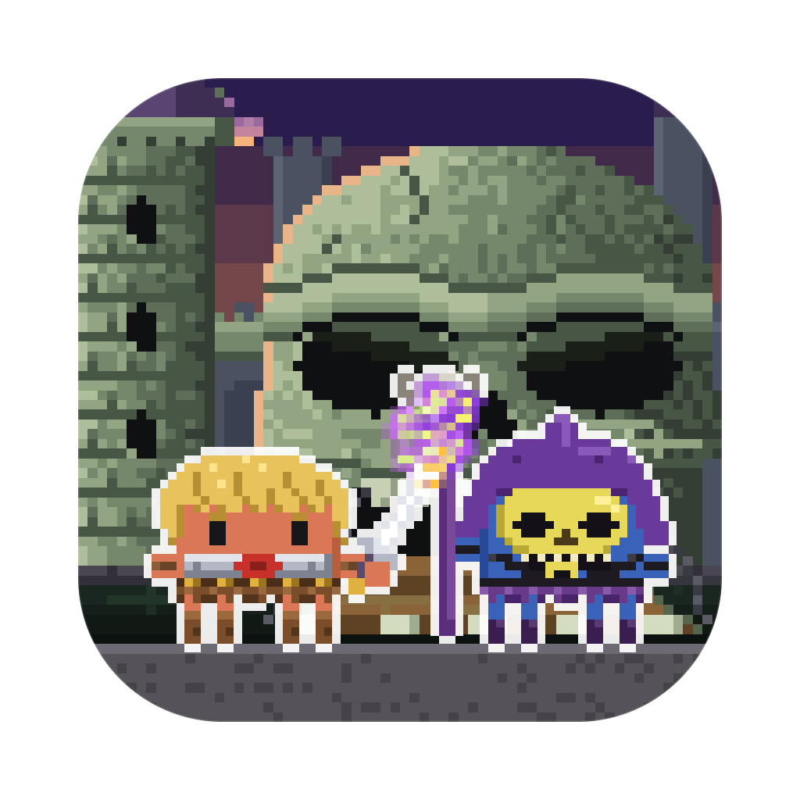
</p>

<h1 align="center">Clawds of the Universe</h1>

<p align="center">
  <b>Your AI coding sessions, as a pixel-art battle for Castle Greyskull on your desktop.</b><br>
  Every session is a Master of the Universe or one of Skeleclawd's Evil Warriors, every subagent joins the fight, and they fight while they work.
</p>

<p align="center">
  <a href="LICENSE"></a>
  
  
  
  <a href="https://github.com/rodclemen/clawd-clash"></a>
</p>

https://github.com/user-attachments/assets/6c5511ba-bc0a-4403-b6aa-c9a50501e095

<p align="center"><sub>🔊 <b>Click the speaker in the player for sound</b>: GitHub starts videos muted. Full 1080p version: <a href="promo/clawds-of-the-universe-promo.mp4">promo/clawds-of-the-universe-promo.mp4</a></sub></p>

> **Clawds of the Universe is a universe of [Clawd Clash](https://github.com/rodclemen/clawd-clash).** Same crew, same fights, more universes to switch to. This page shows off the Clawds of the Universe universe; see [Get it](#get-it) to install.

<p align="center">
  
</p>

---

## Contents

- [What it is](#what-it-is)
- [The Clawds of the Universe universe](#the-clawds-of-the-universe-universe)
- [The cast](#the-cast)
- [The places](#the-places)
- [Get it](#get-it)
- [More universes](#more-universes)
- [What's new](#whats-new)

## What it is

You run Claude Code in three terminals. One is thinking, one is waiting for your permission, one finished ten minutes ago and you didn't notice. You alt-tab around to find out.

**Clawd Clash tells you at a glance, without switching windows.** Every session becomes a character in a pixel-art battle, along the bottom of your screen or in a window of its own: Claude Code's, and those of the other AIs and harnesses Clawd Clash supports ([the full list](https://github.com/rodclemen/clawd-clash#supported-ais-and-harnesses)).

- ⚔️ **Working?** Your Claude swings the Power Sword, cracks Beast Clawd's whip, fires Hordakk's arm cannon or throws Evil-Lynn's magic.
- 💭 **Thinking?** A thought bubble.
- ❗ **Needs you?** A red `!`, and if you ignore it for a minute, it starts jumping up and down. It keeps asking until you answer; press Esc instead and it stands down.
- 😴 **Done and idle?** It stops fighting and passes the time with habits of its own: Orkko's spells go wrong, Cringer hides behind the nearest hero, Two Bad argues with himself and Stinkor clears the room. After a couple of minutes it sits down; after five it's asleep (zZz).
- 🚀 **Spawned subagents?** Every subagent gets to join the fight: they walk in one by one, each labelled with what it's doing, and leave when they finish, by Wind Raider, Roton or Horde rocket.
- 🔍 **Hover** any character for the details: status, how long, the tool it's running, your last prompt.
- 🖱️ **Click** any of them to jump straight to that session's terminal or editor tab.

No dashboard to open, no tab to check. It's just… there. By the power of Greyskull.

## The Clawds of the Universe universe

Run two Claudes and they square off. Every character is Clawd (Claude Code's little pixel mascot) in costume, from the 1983 cartoon, She-Clawd and the 1987 film.

**Arch-enemies face off first.** Whenever a pair is on stage together, everyone else shuffles aside so the two of them can have it out: He-Clawd and Skeleclawd, She-Clawd and Hordakk, Prince Addam and Beast Clawd, Adorra and Katra, Teelah and Evil-Lynn, Man-At-Clawds and Trap Clawd, Battle Kat and Panthor, Orkko and Count Marzo, the Sorceress and Shokoti, Gwildor and Karg, and eighteen more pairs. Skeleclawd and Hordakk never lead two sessions back to back: one cackling skull-face at a time.

**By the power of Greyskull!** When the session of Prince Addam compacts its context, lightning cracks down out of the sky onto him, the screen whites out, and He-Clawd stands there in the last of it: "I have the power!" Adorra becomes She-Clawd in a spiral of gold and rainbow light ("For the honour of Greyskull!"), Cringer becomes Battle Kat and Spirit becomes Swift Wind. At the next compaction the power leaves them the way it came, and they're their plain selves again. Nobody ever meets their other self on stage: the secret is safe.

<p align="center">
  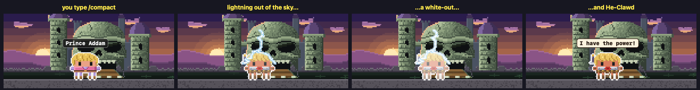
  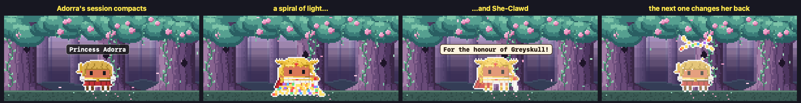
</p>

**The rides.** When an agent is done, it doesn't walk off: the Masters' Wind Raider sets down for them, the rebels ride Swift Wind, Skeleclawd's side rolls up on the Roton, and the Horde leaves by skiff or in Hordakk's rocket. Granamyr flies off on his own wings.

<p align="center">
  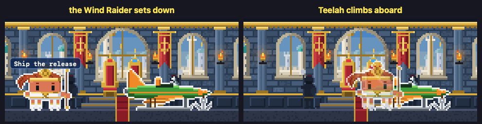
  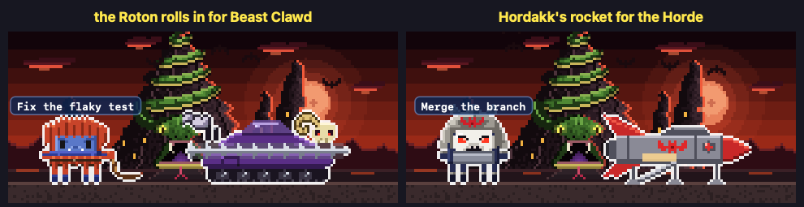
</p>

**The moral of the story.** Every episode ended with a lesson, and so does a hero's work now and then: when their session finishes, they step forward with one. "Remember, kids: always write your tests!"

<p align="center">
  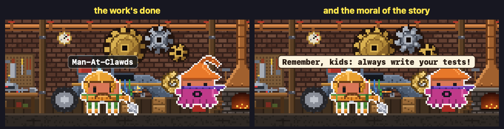
</p>

**"I'll get you for this, He-Clawd!"** Once a fight he was in is over, Skeleclawd shakes his fist and vanishes in a purple puff, and turns up again when the smoke clears.

<p align="center">
  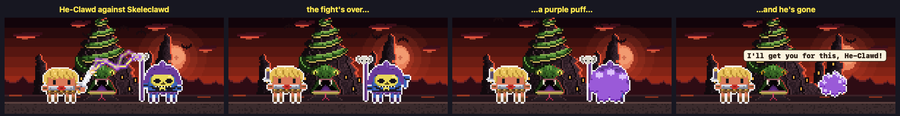
</p>

**Practice.** Between jobs He-Clawd presses a boulder over his head, Teelah runs her staff through a kata, Man-At-Clawds beats out a hot blade at his anvil, Orkko juggles until a ball turns into a fish, Ram Clawd charges a wall and bounces off it, Bow shoots at a target, Jitsu chops a stack of planks, Gwildor tunes the Cosmic Key a note at a time, the Horde Troopers drill with their rifles in step, and Skeleclawd practises his cackle on Screeech.

**Heroes against villains.** Run Claude Code alongside another AI and they pick sides: Claude Code plays the heroes, the others Skeleclawd's Evil Warriors and the Horde, and each one's agents fight for their own side. The outline colour round each character tells you which AI it belongs to.

## The cast

41 villains and 44 heroes, from the 1983 cartoon, She-Clawd and the 1987 film. Nearly all of them can be a session (drawn large) or an agent (drawn small); Loo-Kee, Imp, Screeech, the Horde Troopers and the Dark Troopers only ever come as agents. Most have a signature move, and many an arch-enemy.

**The heroes**: the Masters of the Universe: He-Clawd (raises the Power Sword and lightning strikes its tip), Prince Addam (yawns and stretches, the sword peeking over his shoulder), Battle Kat and Cringer (who covers his eyes and trembles), Orkko (a trick goes wrong and a little rain cloud forms over his own hat), Teelah, Man-At-Clawds (tinkers with his gauntlet in a shower of sparks), the Sorceress of Greyskull (becomes Zoar the falcon for a beat), King Randor and Queen Marlena (puts on her old astronaut's helmet), Stratos, Ram Clawd, Man-E-Clawds (turns his faces: man, robot, monster), Mekaneck (his neck telescopes up for a look round), Buzz-Off, Clawdfist, Roboto, Moss Clawd, Sy-Clawdne, Snout Spout, Zodac (sits down in mid-air on his cosmic chair) and Granamyr (puffs a smoke ring, unimpressed); She-Clawd and the Great Rebellion: She-Clawd (her sword turns into a shield and back), Adorra, Spirit and Swift Wind, Bow (plucks his bow like a harp), Glimmer, Queen Angella, Clawdstaspella, Frosta (freezes the floor and skates a circle), Madame Razz (climbs on Broom, wobbles and falls off), Kowl (rolls his eyes), Sea Hawk, Mermista, Perfuma, Peekablue, Netossa, Flutterina, Light Hope and Stonedar; Loo-Kee, who hides and peeks out; and Gwildor from the film, holding up the Cosmic Key. And now and then HEM turns up as a Master, in a blond pageboy wig and a harness, with a foam Power Sword.

**The villains**: Skeleclawd and the Evil Warriors: Skeleclawd (shakes his fist and cackles), Evil-Lynn (gazes into the orb on her staff), Beast Clawd (cracks his whip and roars), Trap Clawd (chomps his metal jaw), Tri-Clawdps (his three eyes turn round), Mer-Clawd, Kobra Khan, Clawdful, Webstor (dangles upside down on a line), Whiplash, Spikor, Two Bad (his two heads argue), Faker (strikes He-Clawd's pose, sparks fizzing out of his ear), Panthor, Stinkor and Jitsu (chops a plank clean in two); King Hiss (his face peels away to show the snakes), Count Marzo and Shokoti; Hordakk and the Evil Horde: Hordakk (his arm turns into a cannon, with a snorting laugh), Shadow Weaver, Katra (pulls her cat mask down and cracks her whip), Scorpia, Mantenna (his eyes pop out on their stalks), Leach, Grizzlor, Modulok, Multi-Bot, Entrapta, Octavia, Rattlor, Tung Lashor, Vultak and Horde Prime (a huge green hand reaches out of the smoke and points); Blade, Saurod and Karg from the film; and the small fry, only ever agents: Imp (who turns into a stool), Screeech, the Horde Troopers and the Dark Troopers.

<p align="center">
  
</p>

## The places

Clawd Clash opens in a window by default (switch to the desktop from the menu). The whole crew stands in a scene, and every session gets a card: its project, what it's doing right now, your last prompt, its last reply, and its agents in a little tree underneath.

<p align="center">
  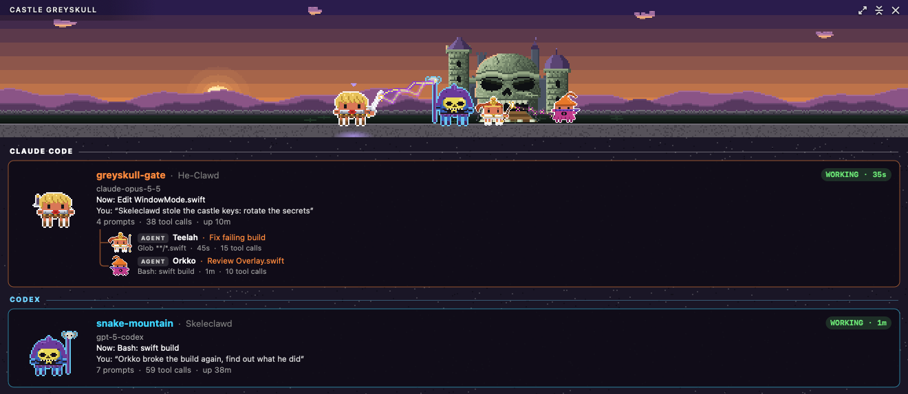
</p>

The scene is set **where the first session's character belongs**: Castle Greyskull for He-Clawd and the Sorceress, the Royal Palace for the royal family, Snake Mountain for Skeleclawd, the Fright Zone for the Horde, the Whispering Woods for the Great Rebellion, Bright Moon for Glimmer, and a small town on Earth for the film's cast.

21 hand-built places, each with its own little animation: green mist curls up out of the chasm under Castle Greyskull; the pool's light ripples on the walls of the Sorceress's chamber; torches flicker in the Royal Palace of Eternos; a cog turns in Man-At-Clawds' workshop; the stone snake's eyes glow on Snake Mountain; fireflies drift in the Vine Jungle; rocks float over the Mystic Mountains; clouds drift past Avion; honey drips in Andreenos; embers rise at Darksmoke; moons orbit Trolla; bubbles rise in Mer-Clawd's undersea kingdom; red eyes blink in the fog of Beast Island; tentacles grab out of the House of Shokoti; smoke belches from the Fright Zone; the crystals twinkle at Bright Moon; Loo-Kee peeks out in the Whispering Woods; a rainbow glows inside the Crystal Castle; the islands bob at Mystacor; snow falls on Castle Chill; and the neon flickers on Earth, where the Cosmic Key's portal now and then opens in an alley.

<p align="center">
  
</p>

When the scene moves somewhere new, it goes the way the show would, and every change ends with the new place's name carved in stone: a sword raised against the dusk and the lightning of By the Power of Greyskull (the rarest); Greyskull's jawbridge dropping like a mouth; Zoar swooping across; Orkko's trick, which lands in two wrong places first ("Oops!"); the Havoc Staff cracking the scene like glass; a crystal orb; the Wind Raider trailing cloud; For the Honour of Greyskull's spiral of gold and rainbow light; the Horde bat closing its wings over the scene; Shadow Weaver's strands weaving it away; a portal between worlds; and Light Hope's rainbow.

<p align="center">
  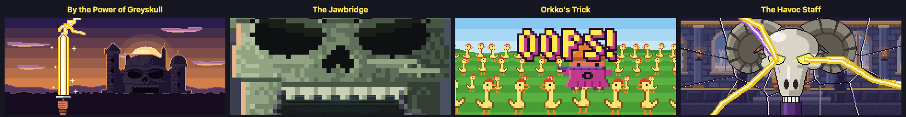
  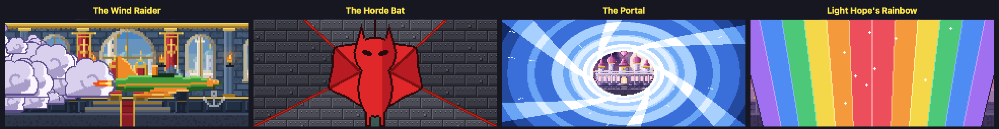
</p>

<details>
<summary><b>All twelve transitions, five moments of each</b></summary>
<p align="center">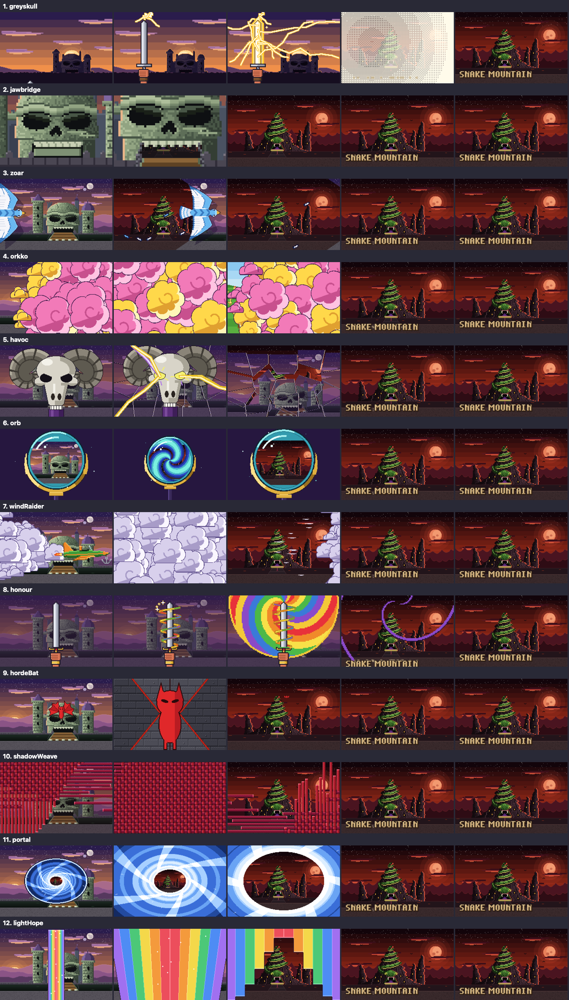</p>
</details>

<p align="center">
  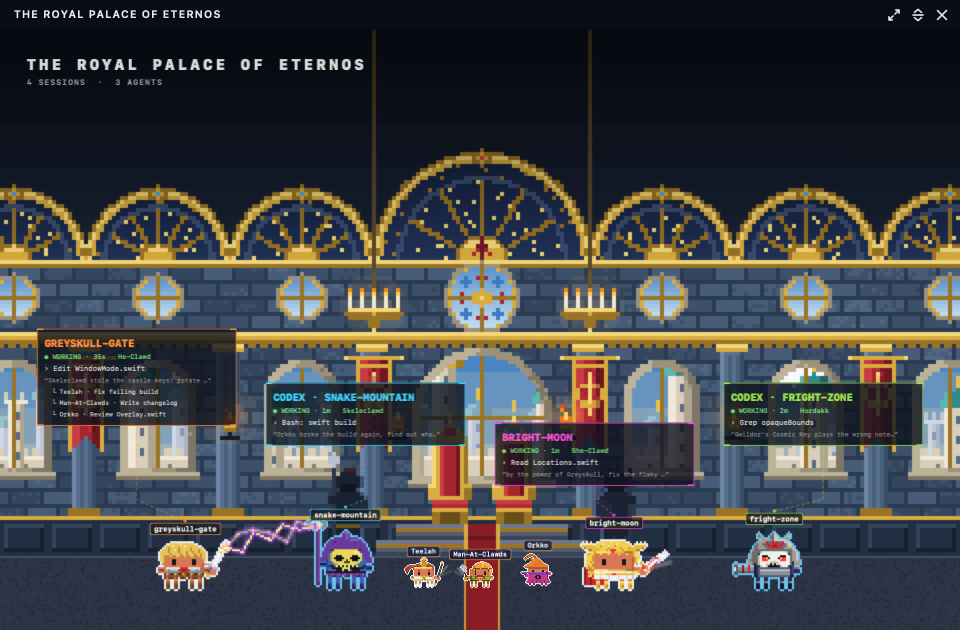
</p>

Clawd Clash also comes with a screen saver: the place at full screen and the crew fighting across its floor, name tags on everyone, a card for each session, and a trip somewhere new every 10 minutes. Pick **Clawds of the Universe** in the screen saver's **Options…** in System Settings.

## Get it

Clawds of the Universe is part of **[Clawd Clash](https://github.com/rodclemen/clawd-clash)**, one app with multiple universes. It needs macOS 13+ and at least one of the [AIs and harnesses it supports](https://github.com/rodclemen/clawd-clash#supported-ais-and-harnesses).

It comes with Clawd Clash 4.2.0 and later. With Homebrew:

```sh
brew tap rodclemen/tap
brew trust rodclemen/tap      # newer Homebrew asks you to trust a third-party tap once
brew install --cask clawds-of-the-universe
```

That's Clawd Clash, starting in Clawds of the Universe (`brew install --cask clawd-clash` gets the same app; then pick **Settings → Universe → Clawds of the Universe**). Already have Clawd Clash? `brew upgrade --cask clawd-clash`. Or download the zip from [Clawd Clash's releases](https://github.com/rodclemen/clawd-clash/releases), unzip it and drag **Clawd Clash** to Applications.

Everything else (how it works, the settings, uninstalling, the source and contributing) lives in the **[Clawd Clash repo](https://github.com/rodclemen/clawd-clash)**.

## More universes

Clawds of the Universe is one of multiple universes. In **Settings → Universe** you can switch to **[Star Clawds](https://github.com/rodclemen/star-clawds)**, **[Marvelous Clawds](https://github.com/rodclemen/marvelous-clawds)**, **[Detective Clawds](https://github.com/rodclemen/detective-clawds)**, **[Doctor Clawd](https://github.com/rodclemen/doctor-clawd)**, **[The Clawd Files](https://github.com/rodclemen/the-clawd-files)**, **[Stevie Clawdberg](https://github.com/rodclemen/stevie-clawdberg)**, **[Clawd of the Rings](https://github.com/rodclemen/clawd-of-the-rings)**, **[Clawd Slayer](https://github.com/rodclemen/clawd-slayer)**, **[Stranger Clawds](https://github.com/rodclemen/stranger-clawds)** or **[Superclawdtural](https://github.com/rodclemen/superclawdtural)**, or pick **Random** to change universe on its own every so often. Switching recasts everyone on screen and moves the scene to one of the new universe's places. Or pick **Clawd Royale** to throw every cast into one scene, each character as themselves, in a new place from any universe every ten minutes.

## What's new

The highlights, in plain words: [CHANGELOG.md](CHANGELOG.md). The full history lives in Clawd Clash.

---

<p align="center"><sub>An independent parody fan project, not affiliated with or endorsed by Mattel, Filmation, DreamWorks or the makers of He-Man and the Masters of the Universe, She-Ra: Princess of Power or the 1987 film. Claude and Clawd belong to Anthropic.<br>Free to use: <a href="LICENSE">MIT licensed</a>.</sub></p>
